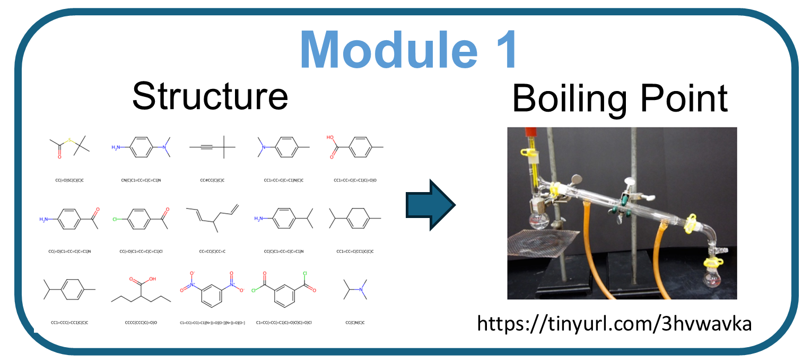

# Boiling-point prediction workshop



## Objective

Use prompts to build, evaluate, and question a machine-learning workflow that predicts
a molecule's reported boiling point from its **SMILES string**. Develop your own
approach using the ten-step template and the completed implementations in `examples/` as
optional references rather than required exercises.

Inputs are molecular structures only; boiling point is the target, not a feature.
The model notebooks report temperatures and prediction errors in **kelvin**.

## Notebook sequence

- [00 — Get data](00_BP_Get_Data_NISTChemPy_v2.ipynb): acquisition pre-work, not a
   live exercise. Collect or reclean NIST records into a SMILES/BP table in kelvin.
- [01 — Ten steps in prompts](01_Ten_Steps_in_Prompts.ipynb): review the template
   and the ten-step workflow before the hands-on exercise.
- [02 — Vibe-coding workbook](02_BP_Vibe_Coding_Workbook.ipynb): copy and adapt the
   opening prompt, then ask your assistant to populate and execute this workbook.

The [examples reference library](examples/README.md) has two parts. `reference_models/`
holds the Chemprop GNN and frozen MoLFormer notebooks. `prompt_iteration/` holds the
same task generated from four prompts that pull different strategy levers (P0–P3), the
executed notebooks, and [a prompt-only notebook](examples/prompt_iteration/Compare_Prompt_Strategies.ipynb)
for asking your assistant to analyze them. Consult these as needed; they are not
additional live steps, the methods are not claimed to be best on this dataset, and their
scores come from different cleaning rules and splits.

## Folder layout

```text
01_boiling_point/
  00_BP_Get_Data_NISTChemPy_v2.ipynb   # acquisition pre-work
  01_Ten_Steps_in_Prompts.ipynb       # workflow template
  02_BP_Vibe_Coding_Workbook.ipynb    # hands-on prompt and workspace
  data/                            # packaged data fallback
  outputs/                         # acquired data and generated results
  examples/
    reference_models/              # Chemprop GNN and frozen MoLFormer notebooks
    prompt_iteration/              # P0–P3 prompts, executed notebooks, comparison prompt
```

Keep shared data and generated artifacts at the module root, not inside `examples/`.

## Before running

Follow the [workshop setup guide](../SETUP_GUIDE.md) and select the workshop `.venv`
kernel in VS Code. During the session, read 01 and copy the prompt in 02 into your
coding assistant; running the prompt-only notebook itself does not call an LLM.
Review the generated code and its real outputs. You can customize the prompt to
create a separate notebook instead, or work interactively one step at a time.

Notebook 00 can cleanse an existing acquisition Parquet without repeating the long
download. Full live collection is optional pre-work; one illustrative NIST fetch still
requires internet. The workbook and reference notebooks prefer `outputs/nist_acquisition/NIST_BP_SMILES.parquet`
when present and otherwise use `data/CompoundData.parquet`. Keep the data source and
split settings unchanged for fair comparisons. Notebook 02 contains a single editable
prompt, not prewritten training code. It asks the assistant to fill out 02 and save
artifacts under `outputs/bp_workbook/`; use separate destinations for independent
attempts. Choose any relevant references from `examples/`; the 02 workbook also has a
strategy toolbox: levers you can add to your prompt to change how the assistant works.
Optional MoLFormer execution downloads its public checkpoint on first use.

## What to take away

Inspect loss curves, the selected checkpoint, held-out parity plots, and failure cases—not
just a convincing single-molecule prediction. Use validation results for development and
reserve test results for final evaluation. Random molecular splits do not establish
performance on unseen chemical scaffolds, and these labels are not verified to share
one measurement pressure. Generated artifacts are saved under `outputs/`.
