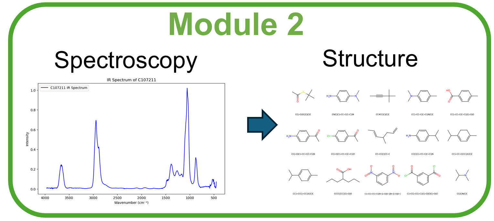

# IR functional-group workshop



> [!IMPORTANT]
> **Download the IR data before starting this module.**
> From [Workshop data v1 → Assets](https://github.com/thiasyoung/2026-avs-ml-vibe-coding-workshop/releases/tag/workshop-data-v1), download **ir_raw_checkpoint.parquet** (about 196 MB), not **Source code**.
> Save it as `02_ir_functional_groups/outputs/nist_acquisition/ir_raw_checkpoint.parquet` relative to your repository root. Create the folders if needed; the file is not included in a clone.

## Objective

Identify **which functional groups are present in a molecule from its IR spectrum**.
This is a multi-label task: one spectrum can have several of the 12 labels, which are
derived from molecular structures using documented SMARTS rules.

The hands-on focus is **data examination and carpentry**, not model tuning. Form a
hypothesis about the data, prompt a coding assistant to implement a justified change,
then measure its effect using the same static neural network and fixed evaluation data.

## Notebook sequence

- [00 — Get data](00_IR_Get_Data_NISTChemPy_v2.ipynb): acquire native NIST spectra,
   their units, SMILES, and labels. This is pre-work, not the live workshop exercise.
- [01 — Vibe-coding carpentry workbook](01_IR_Vibe_Coding_Data_Carpentry.ipynb): edit
   one opening prompt, then ask your coding assistant to implement, execute and check
   the examination and preparation. The fixed input/output contract keeps its results compatible with notebook 02.
- [02 — Static training](02_IR_Optimized_Training.ipynb): select a prepared dataset
   with `CARPENTRY_DIR`; train and evaluate the unchanged functional-group classifier.

Optional [references in examples/](examples/README.md) include the completed 01 minimal
baseline, four alternative carpentry strategies (01a–01d), and the 03 results comparison.
They are reference points, not additional main workshop steps.

Shared data-preparation and validation helpers are in `lib/`. Example strategies
and batch execution/verification scripts are in `examples/`. Notebook setup cells
locate these automatically; data and outputs remain at this module's root.

## From the workbook to training

Edit the starting plan as well as the blanks for your hypothesis, plan, vibe-coding
strategy, effort priorities and budget. Only the **FIXED input/output contracts**
stay unchanged; examination, carpentry and checking methods are editable suggestions.
Copy the entire prompt, including both sections, into your coding assistant.

The workbook prompt asks the assistant to save `IR_train.parquet`,
`IR_validation.parquet`, `IR_test.parquet`, `data_manifest.json` and `cleaning_audit.csv`
under `outputs/workshop_carpentry/`, then point **only** notebook 02's `CARPENTRY_DIR`
there and smoke-test its loader. Then run notebook 02 to train the classifier. Each spectrum has
500 finite values on the frozen grid, with the same ordered 12 binary labels.
The worked baseline keeps using `outputs/carpentry/`, so your exercise does not
overwrite the reference datasets or require changing the static model.

## Before running

Follow the [workshop setup guide](../SETUP_GUIDE.md), select its `.venv` kernel in VS Code,
and run notebooks top-to-bottom from this module folder.

Download [ir_raw_checkpoint.parquet](https://github.com/thiasyoung/2026-avs-ml-vibe-coding-workshop/releases/download/workshop-data-v1/ir_raw_checkpoint.parquet)
from the release above. Within this IR module folder, the destination is:

```text
outputs/nist_acquisition/ir_raw_checkpoint.parquet
```

No extraction or renaming is needed for the Parquet file. Notebook 00 reuses it
with live collection off by default; it does not automatically download a release asset.
You do not need to repeat live NIST acquisition for the workshop. If the release is
unavailable, ask the instructor for the checkpoint or use 00 to acquire it separately.
The included normalized rehearsal datasets cannot replace the native arrays for these exercises.

## Keep the comparison fair

Every preparation must finish with **500 finite spectral features and the same 12 binary
labels**. Keep `data/frozen_evaluation/` unchanged and exclude held-out molecular identities
before training-data carpentry. Notebook 02 fits scaling on training only and selects
checkpoints and thresholds using validation data, not test scores.

Keep architecture and training settings fixed while changing data. Review actual gains,
ties, and regressions: sophisticated cleansing is not guaranteed to help, and each worked
example bundles several choices. Prepared data and model results go under `outputs/`;
worked-example data go under `examples/outputs/`. See the [examples guide](examples/README.md)
for the full preparation/training/comparison command and detailed policies.
